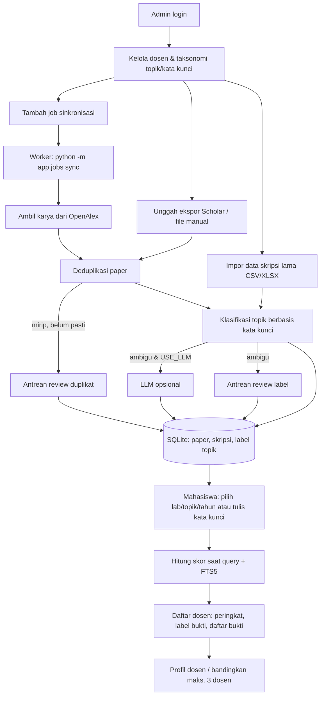

# Teknik dan Alur Sistem Rekomendasi Dosen Pembimbing

Dokumen ini menjelaskan teknik yang dipakai dan alur kerja sistem. Detail kebijakan produk ada di PRD.

## 1. Teknologi

| Bagian | Teknologi |
|---|---|
| Web server | FastAPI + Uvicorn |
| Tampilan | Jinja2 (HTML dirender di server), CSS biasa |
| Database | SQLite lewat SQLModel/SQLAlchemy, migrasi Alembic |
| Pencarian teks | SQLite FTS5 (`app/fts.py`) |
| Ambil data publikasi | OpenAlex API via `httpx` (`app/providers/openalex.py`) |
| Kemiripan judul | `rapidfuzz` (`token_set_ratio`) |
| Impor file | CSV, XLSX (`openpyxl`), BibTeX (`bibtexparser`) |
| Keamanan admin | Hash kata sandi scrypt, cookie sesi bertanda tangan (`itsdangerous`), batas percobaan login |
| LLM (opsional) | API kompatibel OpenAI atau Ollama (`app/llm.py`) |

## 2. Teknik yang dipakai

### 2.1 Pengumpulan data
- **OpenAlex API**, bukan scraping HTML Google Scholar. Sistem mengambil karya dosen berdasarkan ID author OpenAlex, dibatasi jendela publikasi `PUBLICATION_WINDOW_YEARS` (default 3 tahun).
- Abstrak OpenAlex disimpan dalam bentuk *inverted index*, lalu disusun ulang menjadi teks (`reconstruct_abstract`).
- Request yang gagal dengan status 429/5xx diulang (retry).
- Sumber lain: ekspor Google Scholar (BibTeX/CSV), unggahan manual, dan data skripsi lama (CSV/XLSX).

### 2.2 Deduplikasi paper (`app/dedupe.py`)
Paper yang sama dari sumber berbeda digabung dengan urutan pengecekan:
1. DOI yang dinormalisasi
2. ID OpenAlex
3. ID publikasi Scholar
4. Hash judul yang dinormalisasi (huruf kecil, tanpa tanda baca, tanpa stopword), dengan selisih tahun maksimal 1
5. Kemiripan judul fuzzy ≥ 0,90 pada tahun yang sama. Hasil ini tidak digabung otomatis, tapi masuk antrean review admin.

Abstrak tidak pernah dipakai untuk menentukan duplikat. Saat digabung, field yang kosong diisi dan jumlah sitasi diambil yang tertinggi.

### 2.3 Klasifikasi topik (`app/classify.py`)
Klasifikasi **multi-label berbasis aturan kata kunci** dengan taksonomi dua tingkat (topik utama → sub-topik), dikelompokkan per lab.

- Teks paper = judul + venue + abstrak. Teks skripsi = judul.
- Untuk tiap topik dihitung jumlah kata kunci yang cocok (`m`).
- Confidence = `m / (m + 2)`. Contoh: 1 kecocokan = 0,33; 2 = 0,5; 4 = 0,67.
- Ambang: paper ≥ 0,4, skripsi ≥ 0,5.
- Sub-topik dipilih dari sub-topik dengan kecocokan tertinggi. Kalau tidak ada yang lolos ambang, dipakai sub-topik "Umum".
- Hasil dianggap **ambigu** kalau tidak ada label, confidence teratas < 0,5, atau selisih dua label teratas < 0,1. Paper ambigu masuk antrean review.
- Label hasil review admin dikunci (`locked`) dan tidak ditimpa saat klasifikasi ulang.

### 2.4 LLM opsional
Kalau `USE_LLM=true`, hanya paper yang ambigu yang dikirim ke LLM, dalam batch. Hasilnya di-cache memakai hash dari judul, abstrak, dan versi taksonomi, jadi paper yang sama tidak diproses dua kali.

### 2.5 Skor rekomendasi (`app/recommend.py`)
Skor dihitung saat query, tidak disimpan di tabel.

1. **Bobot kebaruan** (peluruhan eksponensial):
   `recency = 0,5 ^ (umur_tahun / RECENCY_HALF_LIFE_YEARS)`. Dengan half-life 2 tahun, paper umur 2 tahun berbobot 0,5.
2. **Kekuatan per topik** untuk tiap dosen:
   `strength = Σ(recency × confidence label paper) + THESIS_LAMBDA × Σ(confidence label skripsi bimbingan)`. Default `THESIS_LAMBDA = 1,5`.
3. **Penyusutan (shrinkage)** supaya satu-dua bukti tidak langsung tampak kuat:
   `score = strength / (strength + 2)`.
4. **Gabungan beberapa topik** yang dicari:
   `topic_part = Σ score × (0,6 + 0,4 × coverage)`, dengan coverage = porsi topik yang dicari dengan strength ≥ 0,3.
5. **Kecocokan langsung**: kata kunci bebas dari mahasiswa dicari di judul/venue paper lewat FTS5. Paper yang cocok menambah `shrink(Σ recency)`.
6. **Skor akhir** = `topic_part + skor kecocokan langsung`. Dosen diurutkan berdasarkan skor akhir, lalu jumlah bukti, lalu nama.

Mahasiswa tidak melihat angka skor. Yang tampil adalah peringkat, label bukti (**Lemah** < 0,20, **Cukup** 0,20–0,45, **Kuat** > 0,45), dan daftar bukti (maks. 5 paper dan 3 skripsi). Dosen tanpa data tampil sebagai "belum ada data".

### 2.6 Job sinkronisasi (`app/sync.py`, `app/jobs.py`)
Sinkronisasi memakai antrean di tabel `sync_jobs`. Admin menambah job dari panel, lalu worker CLI `python -m app.jobs sync` memprosesnya (opsi `--force` dan `--lecturer <id>` tersedia). Dosen yang baru disinkron kurang dari 7 hari dilewati, dan job yang macet lebih dari 30 menit ditandai gagal.

### 2.7 Pencocokan nama dosen (`app/person_names.py`)
Nama dosen dari file impor dinormalisasi dengan membuang gelar (Dr., S.Kom., M.T., dst.) dan tanda baca, supaya "Dr. Budi, S.Kom., M.Kom." cocok dengan "Budi".

### 2.8 Evaluasi (`app/evaluation.py`)
Akurasi klasifikasi bisa diukur terhadap data golden (label manual) dengan precision, recall, dan F1 per topik.

## 3. Alur sistem

### Alur admin
1. Login dengan akun tunggal dari `.env`.
2. Isi data dosen, termasuk ID OpenAlex dan ID Scholar. Bisa diimpor dari file.
3. Atur taksonomi: topik utama, sub-topik, lab, dan kata kunci.
4. Jalankan sinkronisasi publikasi, unggah ekspor Scholar, dan impor data skripsi.
5. Selesaikan antrean review: duplikat yang meragukan dan label topik yang ambigu.
6. Setelah taksonomi diubah, jalankan klasifikasi ulang (`python -m app.jobs reclassify`).

### Alur mahasiswa
1. Buka halaman publik.
2. Pilih lab, topik, sub-topik, atau rentang tahun, dan/atau tulis kata kunci judul skripsi.
3. Kata kunci bebas diklasifikasikan ke topik dan juga dicari langsung di judul paper.
4. Sistem menampilkan dosen berurutan dengan label bukti dan contoh paper/skripsi.
5. Mahasiswa membuka profil dosen atau membandingkan sampai 3 dosen.
6. Halaman "Topik" menampilkan dosen teratas untuk tiap topik per lab.

## 4. Deploy

Aplikasi berjalan sebagai satu container Docker (lihat `Dockerfile`): proses web Uvicorn di port 8000, database SQLite di volume `/data`, dan healthcheck di `/health`. Worker `python -m app.jobs sync` dijalankan terpisah, misalnya lewat cron di server yang sama.

Pilihan tempat deploy yang cocok: VPS (Docker), Railway, Render, atau Fly.io, dengan syarat ada **persistent volume** untuk file SQLite.

**Streamlit Community Cloud tidak cocok** untuk sistem ini, karena:
- Streamlit Cloud hanya menjalankan aplikasi yang ditulis dengan library Streamlit. Sistem ini aplikasi FastAPI dengan template HTML, jadi tidak bisa dijalankan di sana tanpa menulis ulang seluruh antarmuka.
- Penyimpanan file di Streamlit Cloud tidak permanen. Database SQLite akan hilang saat aplikasi restart atau tidur.
- Tidak ada proses worker terpisah atau cron untuk menjalankan job sinkronisasi.
